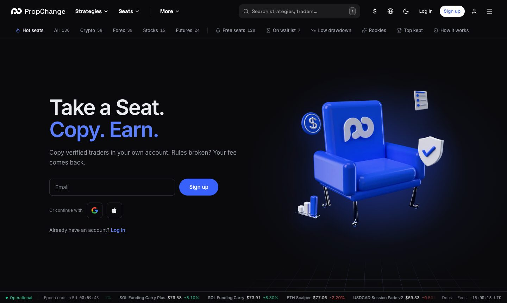
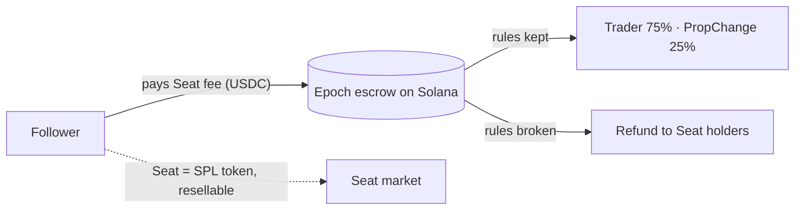
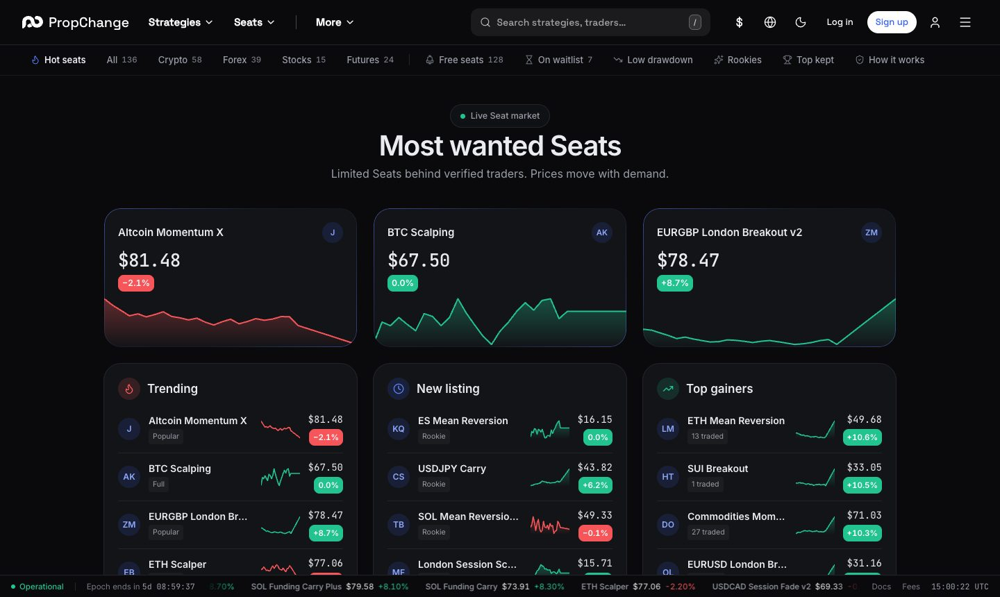
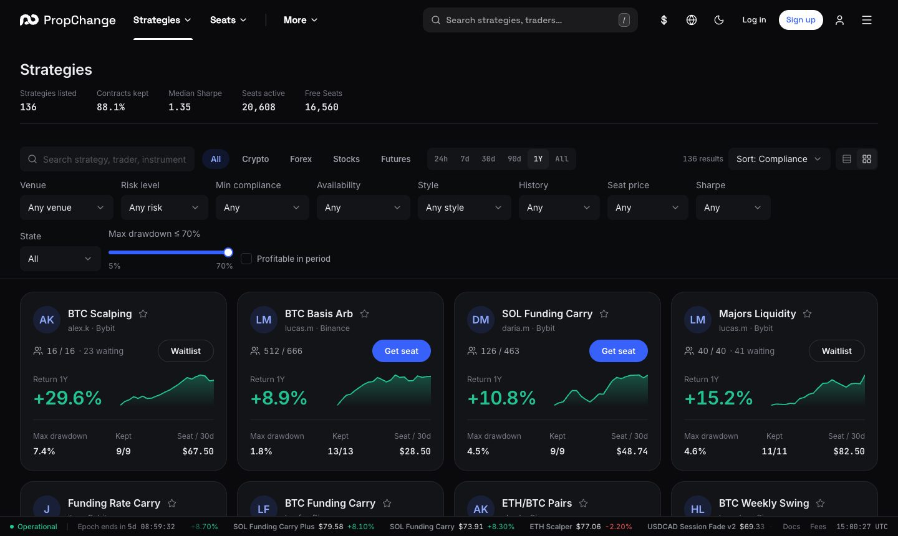
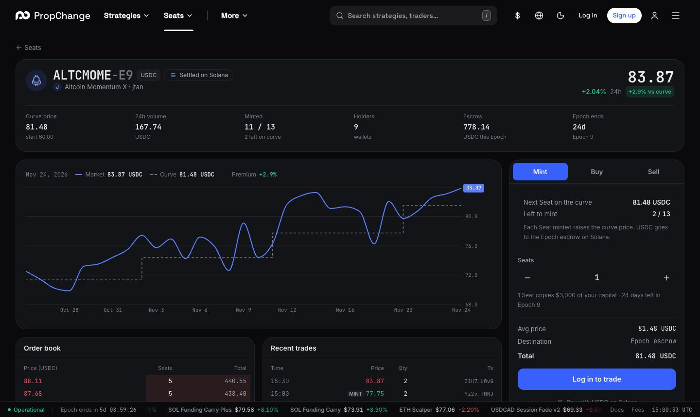

<div align="center">

# PropChange

**The Seat Market for copy trading — on Solana.**

Copy verified traders in your own exchange account. Rules broken? Your fee comes back.

[Live app](https://propchange.vercel.app) · [Landing & waitlist](https://join-propchange.vercel.app) · [How it works](https://propchange.vercel.app/how-it-works)



</div>

## The problem

Copy trading platforms rank traders by past returns and let unlimited followers pile in. Track records can be
cherry-picked, late followers become exit liquidity, and when a trader blows up the follower simply loses money —
nobody is accountable.

## The idea: a Seat

PropChange turns a trader's discipline into a tradable asset.

- **Limited Seats.** Each strategy has a measured capacity, split into a fixed number of Seats. When they are gone,
  you join the waitlist or buy one from a current holder.
- **Seat Contract.** Before every 30-day Epoch, rules are derived from the strategy's own history: max drawdown,
  daily loss, leverage, position size, allowed instruments.
- **Escrow and refund.** The Seat fee is paid in USDC and held in escrow. Contract kept → the trader is paid.
  Contract broken → copying stops and the fee is refunded.
- **Your money stays with you.** Trades are copied into your own Binance / Bybit / MT5 account through a
  trade-only API key. Keys with withdrawal permission are rejected.



**Business model:** 25% of every Seat fee when a contract is kept, and 2% of every Seat resale.

## What's in the app

| | |
|---|---|
|  |  |
| **Seat market** — trending Seats, new listings, top gainers | **Strategies** — verified traders, returns, drawdown, kept contracts |
|  | |
| **Seat trading** — mint on a bonding curve, buy and sell on the order book, on-chain details | |

- Landing, Seat market, strategy analytics (performance, equity curve, drawdown, daily P&L, monthly returns)
- Seat trading screen: mint / buy / sell, order book, recent trades, on-chain panel
- Follower area: active Seats, escrow, refunds, Risk Engine activity, connections
- Trader area: earnings, upcoming settlements, contract health per strategy
- Phantom wallet connect, light / dark theme, 13 languages, USD / EUR / UAH

## Status

| Part | State |
|---|---|
| Web app (UI, flows, analytics) | ✅ Working prototype — [propchange.vercel.app](https://propchange.vercel.app) |
| Data | Demo data from a deterministic mock layer (`prototype/lib/mock-api.ts`); no real money |
| Wallet | Phantom connect (falls back to a demo wallet when Phantom isn't installed) |
| Solana program (Seat mint + USDC escrow + refund) | 🛠 In progress on devnet |

## Repository

| Folder | What |
|---|---|
| [`prototype/`](prototype) | **Main web app** (Next.js 16, deployed to propchange.vercel.app) — see [`prototype/README.md`](prototype/README.md) |
| [`landing/`](landing) | Waitlist landing with feedback forms — [join-propchange.vercel.app](https://join-propchange.vercel.app) |
| [`redesign/`](redesign) | Earlier single-page Seats exploration, kept for reference |
| [`docs/`](docs) | Screenshots used in this README |

## Run locally

```bash
cd prototype
npm install
npm run dev        # http://localhost:3100
npm run typecheck
npm run build
```

Requires Node ≥ 20.9. No environment variables are needed for local development (see `prototype/.env.example`).

## Tech

Next.js 16 (App Router) · React 19 · TypeScript · Tailwind CSS · Radix UI · TanStack Table · Solana (Phantom, SPL
Token-2022 design for Seats, USDC) · Vercel

## Dev3pack Global Hackathon

This project is entered in the Dev3pack Global Hackathon (27–29 Nov 2026).

- **Built before the hackathon:** everything up to the git tag
  [`pre-dev3pack`](https://github.com/dimitrijnemesh/propchange/tree/pre-dev3pack) (web app, landing, design) —
  screenshots of that state: [`docs/before-hackathon`](docs/before-hackathon).
- **Built during the hackathon:** every commit after the tag —
  [compare `pre-dev3pack...main`](https://github.com/dimitrijnemesh/propchange/compare/pre-dev3pack...main).

## Team

**Dimitrii Nemesh** — founder. Lost money copy trading, then built the product that would have prevented it.
