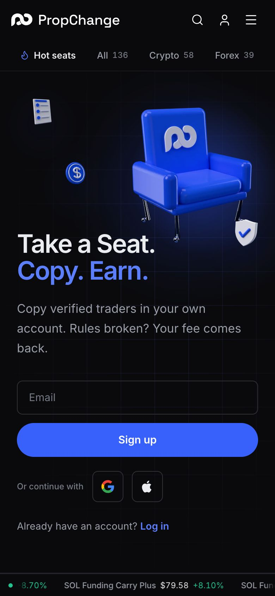
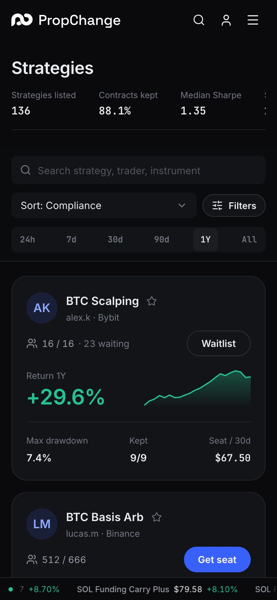
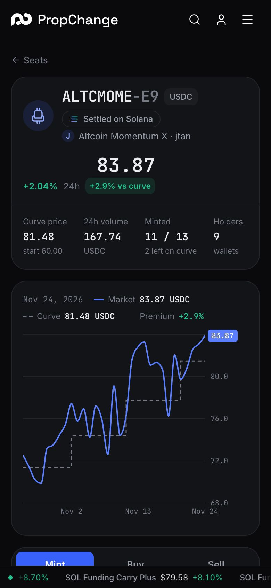
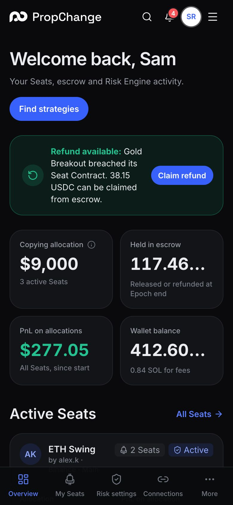
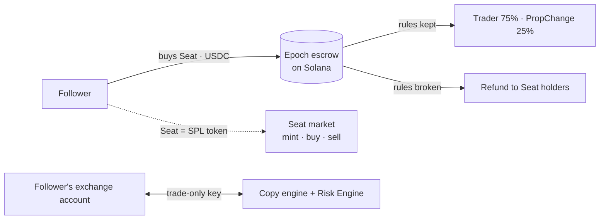
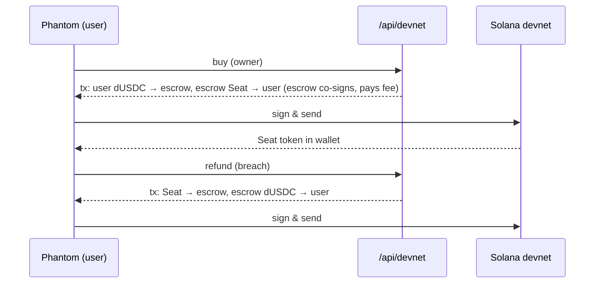

<p align="center">
  <picture>
    <source media="(prefers-color-scheme: dark)" srcset="docs/brand/logo-white.svg" />
    
  </picture>
</p>

<h1 align="center">PropChange</h1>

<p align="center"><strong>Take a Seat. Copy. Earn.</strong> The Seat Market for copy trading on Solana.</p>

<p align="center">
  <a href="https://propchange.vercel.app"></a>
  <a href="https://explorer.solana.com/address/9ae4gCdmfLqPGYDgGU7p5jryV1zJyBWXPBwFB3TbPeUa?cluster=devnet"></a>
  
  
  
</p>

PropChange turns a trader's discipline into a tradable asset. Every strategy has a limited number of
**Seats**. A Seat lets you copy the strategy in your own exchange account under a **Seat Contract** — rules
taken from the trader's own history. The Seat fee is paid in USDC and held in escrow for the 30-day Epoch:
if the trader keeps the rules, they get paid; if they break them, copying stops and **your fee comes back**.

## Links

| | |
|---|---|
| Live app | https://propchange.vercel.app |
| Landing & waitlist | https://join-propchange.vercel.app |
| How it works | https://propchange.vercel.app/how-it-works |
| Fees | https://propchange.vercel.app/fees |
| Demo video | _coming with the Dev3pack submission_ |

<p align="center">
  
  
  
  
</p>
<p align="center">
  
  
</p>

## Why

Copy trading ranks traders by past returns and lets unlimited followers pile in. Track records get
cherry-picked, late followers become exit liquidity, and when a trader blows up, the follower just loses —
nobody is accountable. PropChange makes the trader accountable: no rules kept, no pay.

## What it does

- **Limited Seats.** Each strategy has a measured capacity split into a fixed number of Seats. When they're gone,
  you join the waitlist or buy a Seat from a current holder.
- **Seat Contract.** Before every Epoch, limits are derived from the strategy's own history: max drawdown, daily
  loss, leverage, single position size, allowed instruments, minimum activity.
- **Escrow and refund.** The Seat fee (USDC) sits in an Epoch escrow. Kept → 75% to the trader, 25% to
  PropChange. Broken → copying stops and Seat holders are refunded.
- **Seat = token.** One Seat is one SPL token (Token-2022 design). New Seats are minted on a bonding curve;
  existing Seats trade on an order book, with a 2% platform fee on resales.
- **Your money stays with you.** Trades are copied into your own Binance, Bybit or MT5 account through a
  trade-only key; keys with withdrawal permission are rejected.
- **Analytics a trader can't fake.** Time-weighted returns, equity curve, drawdown, daily P&L calendar,
  monthly returns, risk flags and the full contract history (kept / breached) per Epoch.
- **Follower and trader areas.** Active Seats, escrow, refunds and Risk Engine activity for followers;
  earnings, upcoming settlements and contract health for traders.
- **Live on Solana devnet.** The ALTCMOME-E9 Seat is a real Token-2022 token: connect Phantom, get test USDC, buy a Seat (USDC into escrow and the Seat token to you in one transaction) and simulate a breach (Seat back, USDC back) — every step on-chain with an Explorer link.
- **Also:** fee calculator, "find your Seat in 3 questions", Simulate breach on every Seat in the dashboard, live-ticking prices, light / dark theme, 13 languages, prices in USD / EUR / UAH.

## How a Seat works



## Status

| Part | State |
|---|---|
| Web app — landing, market, analytics, trading screen, follower & trader areas | ✅ Live at [propchange.vercel.app](https://propchange.vercel.app) |
| Data | Demo data from a deterministic mock layer (`prototype/lib/mock-api.ts`) — no real money |
| Solana devnet | ✅ Seat token **ALTCMOME-E9** + test USDC live; buy and refund are real transactions (Phantom via Wallet Standard) |
| Escrow | A devnet escrow wallet operated by the app server (`/api/devnet`) — an on-chain Anchor escrow program is the next step |

## On Solana devnet

| What | Address |
|---|---|
| Seat token **ALTCMOME-E9** (Token-2022, 13 Seats) | [`9ae4gCdmfLqPGYDgGU7p5jryV1zJyBWXPBwFB3TbPeUa`](https://explorer.solana.com/address/9ae4gCdmfLqPGYDgGU7p5jryV1zJyBWXPBwFB3TbPeUa?cluster=devnet) |
| Test USDC **dUSDC** (Token-2022, 6 decimals) | [`2E8nRAkBfsoHeomhMHKhkbHnPEE4UVxecdq1t2GP2gbu`](https://explorer.solana.com/address/2E8nRAkBfsoHeomhMHKhkbHnPEE4UVxecdq1t2GP2gbu?cluster=devnet) |
| Escrow | [`FMpGes9KgWbSn1oisHyXawiiGcMvZddx6JbcqNDa4HRL`](https://explorer.solana.com/address/FMpGes9KgWbSn1oisHyXawiiGcMvZddx6JbcqNDa4HRL?cluster=devnet) |

**Try it:** set Phantom to Devnet (Settings → Developer Settings → Testnet Mode), open
[/seats/alt-momentum-x](https://propchange.vercel.app/seats/alt-momentum-x) and use the **Live on Solana devnet** panel:
Connect → Get 100 test USDC → Buy 1 Seat → Simulate breach → refund. The escrow pays every network fee, so you
don't need devnet SOL.



## Repository map

| Folder | What it is | Stack | Docs |
|---|---|---|---|
| [`prototype`](prototype) | **Main web app**, deployed to propchange.vercel.app | Next.js 16, React 19, TypeScript, Tailwind 4, Radix UI | [README](prototype/README.md) |
| [`landing`](landing) | Waitlist landing with feedback forms | Next.js, TypeScript, Google Apps Script | [README](landing/README.md) |
| [`redesign`](redesign) | Earlier single-page Seats exploration, kept for reference | Next.js, TypeScript | — |
| [`docs`](docs) | Screenshots, brand assets, before-hackathon record | Markdown, images | [before-hackathon](docs/before-hackathon) |

## How to run it

### A. Just try it

Open https://propchange.vercel.app. Browsing needs no account; to trade a Seat, sign up (demo account) and
connect the built-in demo wallet. Everything runs on demo data — no real wallet or money is involved.

### B. Run the web app locally

Requirements: Node.js ≥ 20.9.

```bash
cd prototype
npm install
npm run dev          # http://localhost:3100
```

No environment variables are needed locally. Optional: `NEXT_PUBLIC_SITE_URL` (see `prototype/.env.example`)
for canonical URLs, the sitemap and social cards.

```bash
npm run typecheck    # tsc --noEmit
npm run build        # production build
```

Devnet (optional): `node scripts/devnet-setup.mjs` creates the escrow keypair in `~/.config/propchange/` (never
committed), the test USDC and the Seat token, and writes the public addresses to `lib/devnet-config.json`.
On Vercel the escrow key comes from the `DEVNET_ESCROW_SECRET` env var. `node scripts/devnet-e2e.mjs [url]`
runs faucet → buy → refund with a throwaway wallet.

## Dev3pack Global Hackathon

PropChange is entered in the Dev3pack Global Hackathon (27–29 Nov 2026).

- **Built before:** everything up to the tag
  [`pre-dev3pack`](https://github.com/dimitrijnemesh/propchange/tree/pre-dev3pack) — screenshots in
  [`docs/before-hackathon`](docs/before-hackathon).
- **Built during:** every commit after the tag —
  [compare `pre-dev3pack...main`](https://github.com/dimitrijnemesh/propchange/compare/pre-dev3pack...main). Highlights:
  - Solana devnet: Seat token + test USDC (Token-2022 with on-chain metadata), `/api/devnet` (faucet, atomic
    buy, atomic refund), Phantom via Wallet Standard, Live on devnet panel with Explorer links
  - Simulate breach on every Seat, fee/refund calculator, Find your Seat in 3 questions, live-ticking prices
  - Landing rework (BingX/NextVibe-style sections, real iPhone 17 Pro frames, scroll reveal), restyled auth pages

## Team

**Dimitrii Nemesh** — founder. Lost money copy trading, then built the product that would have prevented it.
